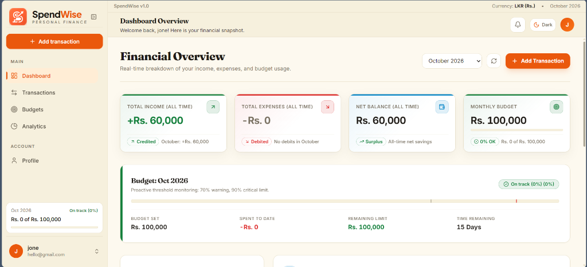
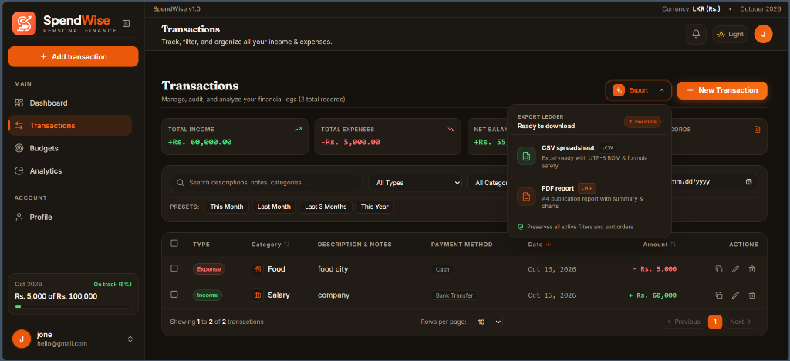
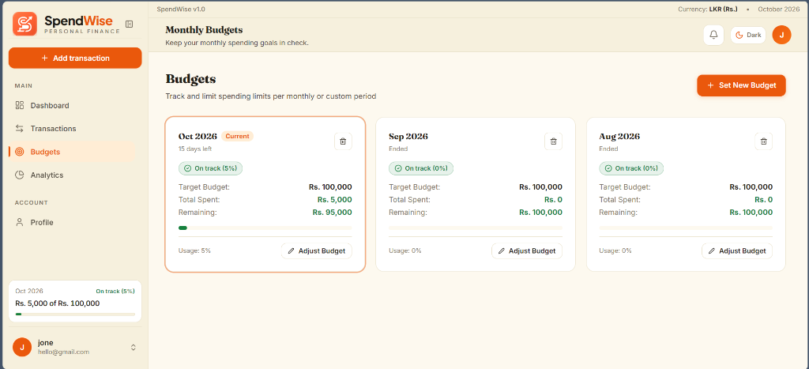
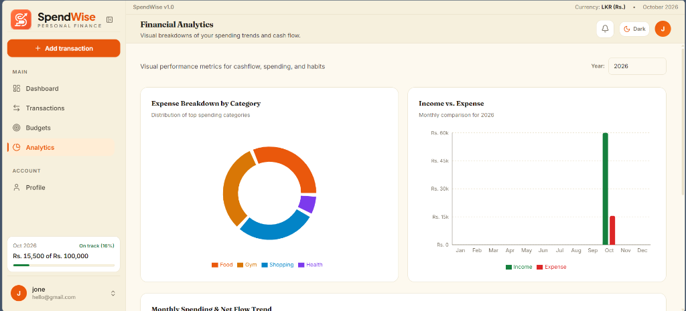

# SpendWise — Personal Expense & Budget Tracker

<p align="center">
  
</p>

<p align="center">
  <strong>A premium, full-stack personal finance application designed for mindful cash flow management, budget discipline, and actionable financial intelligence.</strong>
</p>

<p align="center">
  
  
  
  
  
  
</p>

<p align="center">
  
</p>

---

## 📖 Overview

**SpendWise** is a modern MERN-stack personal finance tracker crafted with the visual elegance and refined UX of premier fintech platforms. Built to support Sri Lankan Rupee (`LKR`) cash flows with locale-aware formatting (`Rs. 250,000`), SpendWise empowers individuals to track income streams, categorize daily expenses, enforce monthly budget limits with dynamic visual alerts, and gain instant clarity over cash flow trends. With warm cream light mode and warm obsidian dark mode, focus management, double-submission safeguards, and strict resource-level authorization checks, SpendWise delivers an enterprise-grade experience for university evaluation and daily personal budgeting.

---

## 🌟 Key Features

- **Authentication & Security:**
  - Secure JWT-based authentication with bcrypt-hashed passwords (salt rounds: 12).
  - Centralized Axios interceptors for automatic Bearer token injection and global 401 handling.
  - In-memory rate limiting on authentication routes protecting against brute-force attacks.
  - Security headers enforced (`X-Content-Type-Options: nosniff`, `X-Frame-Options: DENY`, `X-XSS-Protection`).
  - Strict ownership checks on every database query (`userId: req.user._id`) eliminating Insecure Direct Object References (IDOR).
  - Sanitized update payloads preventing mass-assignment vulnerabilities.

- **Dynamic Financial Dashboard:**
  - Aggregated real-time metrics: Total Income, Total Expenses, Net Savings, and Monthly Budget Status.
  - Month and year filter dropdown enabling historical inspection.
  - Interactive cash flow comparison bar chart and expense-by-category breakdown donut chart.
  - Recent transactions overview with authentic empty states when no activity exists.

- **Transaction Management:**
  - Comprehensive CRUD operations for Incomes and Expenses.
  - Server-side and client-side multi-filter engine: search by keyword, filter by Type, Category, and Date ranges.
  - Sri Lankan Rupee (`LKR`) formatting using `Intl.NumberFormat('en-LK')`.
  - Accessible modal dialogs with auto-focus management and double-submission protection.
  - Categorized using modern Lucide icons (zero emojis) across 15+ standard life categories.

- **Monthly & Custom Period Budget Discipline:**
  - Support for traditional **Calendar Month** budgets (1st to end-of-month) and **Custom Period** budgets (e.g. 15 Oct to 14 Nov) for users whose income cycle does not align with the 1st.
  - Interactive Budget Modal with segmented tab navigation, quick presets ("Salary day" 1–31, "Next 30 days", "This month", "Next month"), and live per-day expenditure estimation.
  - Strict server-side overlap prevention: forbids overlapping budget intervals while permitting adjacent boundaries, returning informative HTTP 409 conflict notifications.
  - Automatic progress indicators with percentage calculations and 3-tier threshold warning states:
    - **Safe** (green, < 70%)
    - **Approaching Limit / Warning** (amber, 70% – 89%)
    - **Critical / Over Budget Alert** (red, >= 90% or spent > budget)
  - Single-pipeline MongoDB `$facet` aggregation computing spent, remaining balance, and days remaining on the server.
  - Accessible custom confirmation dialog (`role="alertdialog"`) for destructive budget deletions.

- **Intelligent Budget & Threshold Notifications:**
  - Real data-driven alerts derived strictly from active budgets, configurable thresholds, and recorded transactions (zero fake data).
  - 5 deterministic notification types:
    - `budget_warning`: Active budget reaches warn threshold (default 70%).
    - `budget_critical`: Active budget reaches danger threshold (default 90%).
    - `budget_exceeded`: Spending exceeds 100% of budget.
    - `budget_ending`: Budget period ends within 3 days with remaining balance.
    - `no_budget`: User has recorded transactions this month without setting an active budget.
  - Deterministic unique compound keys (`{ userId, key }`) guaranteeing zero duplicates upon polling, window focus, or concurrent syncs.
  - Non-blocking sync triggers after transaction, budget, and threshold changes.
  - Top bar interactive bell with accurate unread badge (1 to 9+), polite ARIA live region, and micro-animation on new alerts.
  - Portal-rendered floating popover (`NotificationsPanel`) on desktop with dynamic viewport positioning, edge flipping, and zero clipping by app scrollers.
  - Mobile bottom sheet with body scroll lock and focus management.
  - Dedicated `/notifications` page with All/Unread tabs, server-side pagination, mark all as read, and optimistic dismissal.
  - Strict user data isolation and cascade deletion on permanent account removal.

- **Financial Analytics & Trends:**
  - 6-month historical cash flow trends via Recharts area and bar visualizations.
  - Category-level distribution donut chart with percentages and formatted amounts.
  - Theme-adaptive chart color tokens synchronizing seamlessly with both light and dark themes.

- **User Profile & Account Settings:**
  - Account overview showing member registration tenure, active monthly budget, and transaction counts.
  - Profile name update with length validation (2 to 50 characters).
  - Secure password modification requiring current password verification and minimum 6-character complexity.
  - Multi-currency preference selector allowing users to switch base currency between Sri Lankan Rupee (`LKR • Rs.`) and US Dollar (`USD • $`), updating formatting across all views reactively.
  - Theme toggle selector preserving user preference in `localStorage`.

- **Fintech Features & Security Showcase:**
  - Landing page Core Features section with full-bleed fintech 3D visual background assets (`features-bg.webp`, `features-bg-dark.webp`), `.feature-glass-card` styling, accent washes, and zero-dependency SVG/CSS fallback.
  - 6 glass-style cards with visual stages: transactions tracking with tabular-nums, budget progress with 3-tier threshold indicators (`getBudgetStatus`), live SVG donut & bars charts, verified category chips, highlighted search filters, and an interactive light/dark theme switch.
  - "Also included" feature chips for CSV/PDF export, server pagination, instant undo delete, and 3-tier alert thresholds.
  - Landing page Security section with full-bleed frosted-glass background assets (`security-bg.webp`, `security-bg-dark.webp`) and zero-dependency SVG/CSS dotted grid fallback.
  - 4 clean glass-style security cards for JWT authentication, 12-round bcrypt password hashing, Express protected routes, and strict server-side validation.

---

## 💻 Tech Stack

| Layer | Technologies |
|---|---|
| **Frontend Framework** | React.js (v18.2) + Vite build tool |
| **Styling & Design System** | Tailwind CSS (v3.4), Custom Design Tokens (Cream & Dark), Fraunces & Inter fonts |
| **Icons & Visuals** | Lucide-React (100% SVG icons, zero unicode emojis) |
| **Data Visualization** | Recharts (ResponsiveContainer, BarChart, PieChart, AreaChart) |
| **Routing & Notifications** | React Router v6, React Hot Toast |
| **Backend Runtime** | Node.js (v18+) with Express.js |
| **Database & ODM** | MongoDB Atlas / Local MongoDB, Mongoose v8 |
| **Security & Auth** | JSON Web Tokens (`jsonwebtoken`), `bcryptjs`, Custom Rate Limiter |
| **HTTP Client** | Axios with request & response interceptors |

---

## 📁 Project Architecture

```
spendwise/
├── backend/
│   ├── config/
│   │   └── db.js                 # Mongoose connection handler
│   ├── controllers/
│   │   ├── authController.js       # Register, Login, Me, Profile & Password
│   │   ├── budgetController.js     # Budget CRUD with user ownership verification
│   │   ├── dashboardController.js  # MongoDB aggregations for summaries & charts
│   │   └── transactionController.js# Transaction CRUD, filtering & pagination
│   ├── middleware/
│   │   ├── authMiddleware.js       # JWT bearer token verification
│   │   └── security.js             # Security headers & auth rate limiting
│   ├── models/
│   │   ├── Budget.js               # Budget schema with compound unique index
│   │   ├── Transaction.js          # Transaction schema with indexes on userId & date
│   │   └── User.js                 # User schema with pre-save bcrypt hook
│   ├── routes/
│   │   ├── authRoutes.js           # Auth endpoint definitions
│   │   ├── budgetRoutes.js         # Budget endpoint definitions
│   │   ├── dashboardRoutes.js      # Dashboard aggregation endpoints
│   │   └── transactionRoutes.js    # Transaction endpoint definitions
│   ├── .env.example                # Documented backend environment template
│   ├── package.json                # Dependencies & seed scripts
│   ├── seed.js                     # Idempotent LKR seed script for demonstration
│   └── server.js                   # Express application entry point
├── frontend/
│   ├── public/
│   │   ├── favicon.svg             # Application favicon
│   │   ├── spendwise-logo-light.svg# Light theme vector logo
│   │   └── spendwise-logo-dark.svg # Dark theme vector logo
│   ├── src/
│   │   ├── components/
│   │   │   ├── common/
│   │   │   │   ├── CategoryIcon.jsx    # Accessible Lucide category renderer
│   │   │   │   └── ConfirmDialog.jsx   # Accessible alertdialog modal
│   │   │   ├── dashboard/              # Stat cards, donut chart, cashflow chart
│   │   │   ├── BudgetModal.jsx         # Accessible budget editor
│   │   │   ├── Layout.jsx              # App layout with Sidebar & Navbar
│   │   │   ├── Navbar.jsx              # Header with user menu & theme toggle
│   │   │   ├── PrivateRoute.jsx        # Protected route guard
│   │   │   ├── Sidebar.jsx             # Navigation sidebar with responsive drawer
│   │   │   └── TransactionModal.jsx    # Add/edit transaction dialog
│   │   ├── context/
│   │   │   ├── AuthContext.jsx         # Global user & authentication state
│   │   │   └── ThemeContext.jsx        # Light/dark theme provider
│   │   ├── hooks/
│   │   │   └── useDocumentTitle.js     # Dynamic browser tab title updater
│   │   ├── pages/
│   │   │   ├── Analytics.jsx           # Trends & category distribution
│   │   │   ├── Budgets.jsx             # Monthly budget cards & progress
│   │   │   ├── Dashboard.jsx           # Financial overview & stat cards
│   │   │   ├── LandingPage.jsx         # SaaS marketing homepage
│   │   │   ├── Login.jsx               # Split-screen fintech login page
│   │   │   ├── NotFound.jsx            # Custom 404 page with return route
│   │   │   ├── Profile.jsx             # Account settings & password update
│   │   │   ├── Register.jsx            # Split-screen registration page
│   │   │   └── Transactions.jsx        # Filterable transaction ledger
│   │   ├── utils/
│   │   │   ├── api.js                  # Axios client with interceptors
│   │   │   └── helpers.js              # LKR currency & date utilities
│   │   ├── App.jsx                     # Route matrix & notification toasts
│   │   ├── index.css                   # Tailwind tokens & custom theme variables
│   │   └── main.jsx                    # React virtual DOM root
│   ├── package.json                    # Frontend dependencies
│   ├── tailwind.config.js              # Tailwind custom theme token mappings
│   └── vite.config.js                  # Vite server & API proxy configuration
├── docs/
│   └── screenshots/                    # Evaluation & demonstration screenshots
├── .gitignore                          # Git ignore rules protecting secrets
└── README.md                           # Comprehensive documentation
```

---

## ⚡ Prerequisites

Before installing SpendWise, verify that the following dependencies are installed on your machine:
- **Node.js**: v18.0.0 or higher ([Download Node.js](https://nodejs.org/))
- **npm**: v9.0.0 or higher (packaged with Node.js)
- **MongoDB**: Either a local instance running on `localhost:27017` or a free [MongoDB Atlas Cluster](https://www.mongodb.com/atlas)
- **Git**: Installed for version control

---

## 🛠️ Step-by-Step Setup Guide

### 1. Clone the Repository
```bash
git clone https://github.com/tasunthachathunika/spendwise-expense-tracker.git
cd spendwise-expense-tracker
```

### 2. Configure Backend Environment
Navigate into `backend/` and copy the sample environment file:
```bash
cd backend
cp .env.example .env
```
Edit `backend/.env` with your preferred settings:
```ini
PORT=5000
MONGO_URI=mongodb+srv://<username>:<password>@cluster.mongodb.net/spendwise?retryWrites=true&w=majority
JWT_SECRET=spendwise_super_secret_jwt_key_2026
JWT_EXPIRES_IN=7d
NODE_ENV=development
```

### 3. Install Dependencies
Install dependencies for both the backend and frontend:
```bash
# In backend/
npm install

# In frontend/
cd ../frontend
npm install
```

### 4. Seed Realistic Demonstration Data
SpendWise provides a dedicated, idempotent database seed script that populates realistic Sri Lankan Rupee (`LKR`) cash flows spanning the last 6 months for evaluation:
```bash
cd ../backend
npm run seed
```
> **Seeded Demo Account Credentials:**
> - **Email:** `demo@spendwise.lk`
> - **Password:** `SpendWise2026!`
> - **Records:** 51 realistic transactions (Salary, Freelance, Groceries, Rent, Utilities) + 6 monthly budgets.

### 5. Start Development Servers
Start both servers concurrently in separate terminal windows:

**Terminal 1 — Backend:**
```bash
cd backend
npm run dev
# Backend runs at http://localhost:5000
```

**Terminal 2 — Frontend:**
```bash
cd frontend
npm run dev
# Frontend runs at http://localhost:5173
```

Open your browser at `http://localhost:5173` to experience SpendWise!

---

## 🔐 Environment Variables

| Variable Name | Description | Default / Example Value | Required |
|---|---|---|---|
| `PORT` | Port number for the Express API server | `5000` | No (defaults to 5000) |
| `MONGO_URI` | MongoDB connection URI (Atlas or Local) | `mongodb://localhost:27017/spendwise` | **Yes** |
| `JWT_SECRET` | Secret key used to sign and verify JWT tokens | `spendwise_super_secret_jwt_key_2026` | **Yes** |
| `JWT_EXPIRES_IN` | Token expiration duration | `7d` | No (defaults to 7d) |
| `NODE_ENV` | Application execution environment | `development` | No |

---

## 📡 API Endpoint Reference

All endpoints (except public auth & health) require a valid JWT Bearer token in the `Authorization` header: `Bearer <token>`.

### Authentication (`/api/auth`)
| Method | Path | Auth | Description |
|---|---|---|---|
| `POST` | `/api/auth/register` | Public | Register new user account with name, email, password |
| `POST` | `/api/auth/login` | Public | Authenticate user and receive JWT bearer token |
| `GET` | `/api/auth/me` | Bearer | Retrieve profile of the currently logged-in user |
| `PUT` | `/api/auth/profile` | Bearer | Update user display name (2–50 chars) |
| `PUT` | `/api/auth/password` | Bearer | Change account password verifying current password |

### Transactions (`/api/transactions`)
| Method | Path | Auth | Description |
|---|---|---|---|
| `GET` | `/api/transactions` | Bearer | Get paginated transactions with validated query params (`page`, `limit` [10, 25, 50, 100], `sort` [date, amount, category, createdAt], `order` [asc, desc], `type`, `category`, `search`, `startDate`, `endDate`). Deterministic `_id` tiebreaker; returns `pagination` metadata and real-time `summary` totals. |
| `POST` | `/api/transactions` | Bearer | Create a new transaction (`type`, `amount`, `category`, `date`, `paymentMethod`, `description`, optional `notes` up to 200 chars) |
| `GET` | `/api/transactions/:id` | Bearer | Retrieve single transaction by ID (scoped to authenticated user) |
| `PUT` | `/api/transactions/:id` | Bearer | Update transaction fields (whitelisted sanitization, supports `notes`) |
| `DELETE` | `/api/transactions/:id` | Bearer | Delete transaction by ID (scoped to authenticated user) |
| `GET` | `/api/transactions/export` | Bearer | Export all matching transactions respecting active filters and sort. Supports `?format=csv` (streaming CSV with UTF-8 BOM, RFC 4180 escaping, formula-injection protection, capped at 10,000) and `?format=json` (for client-side PDF, capped at 2,000). |
| `DELETE` | `/api/transactions/bulk` | Bearer | Bulk delete up to 100 transactions by ID array (`{ ids: [...] }`), strictly scoped to authenticated user. |
| `GET` | `/api/transactions/categories` | Bearer | Get distinct categories utilized by current user |

### 📤 How to Export Transactions
SpendWise provides two enterprise-grade export mechanisms accessible from the **Export** dropdown button in the Transactions ledger:
1. **Download CSV (`.csv`)**:
   - Streams server-side directly from `GET /api/transactions/export?format=csv` using authenticated Axios blob download.
   - Prepended with a **UTF-8 BOM (`\uFEFF`)** ensuring Microsoft Excel immediately recognizes UTF-8 characters without encoding corruption.
   - **CSV/Formula Injection Protection**: Any cell beginning with `=`, `+`, `-`, `@`, `\t`, or `\r` is automatically neutralized with a leading single quote (`'`), preventing malicious spreadsheet formula execution.
   - Includes standard financial columns: `Date`, `Title`, `Type`, `Category`, `Payment Method`, `Amount` (raw 2-decimal number), and `Notes`.
2. **Download PDF (`.pdf`)**:
   - Lazily loads `jsPDF` and `jspdf-autotable` via dynamic `import()` to preserve a lean initial bundle size.
   - Generates an A4 portrait financial report with SpendWise branding (`#ea580c`), active filters summary, real-time KPI summary cards (Total Income, Total Expenses, Net Balance, Count), repeated table headers on each page, right-aligned amounts (`+Rs.` in green, `-Rs.` in red), zebra striping, and page numbers.

### Budgets (`/api/budgets`)
| Method | Path | Auth | Description |
|---|---|---|---|
| `GET` | `/api/budgets` | Bearer | Retrieve all budgets (calendar-month & custom) for authenticated user with server-side aggregated `spent`, `remaining`, `percent`, `label`, and `daysLeft`. Sorted newest first. |
| `GET` | `/api/budgets/current` | Bearer | Retrieve the active budget covering today (custom or calendar-month) or `null` if none active. |
| `GET` | `/api/budgets/:year/:month` | Bearer | Retrieve calendar-month budget for specific year and month |
| `POST` | `/api/budgets` | Bearer | Create or update budget. Supports calendar-month (`{ month, year, amount }`) and custom period (`{ periodType: "custom", startDate: "YYYY-MM-DD", endDate: "YYYY-MM-DD", amount }`). Enforces overlap prevention (HTTP 409). |
| `PUT` | `/api/budgets/:id` | Bearer | Update existing budget amount or custom dates with user ownership verification and overlap validation. |
| `DELETE` | `/api/budgets/:id` | Bearer | Delete budget by ID (scoped strictly to authenticated user) |

### 🗓️ Custom Period Budget Architecture
SpendWise allows users whose salary or cash-flow cycle does not begin on the 1st of the month (e.g. salary received on the 15th) to define flexible custom periods:
1. **Date-Only Convention**:
   - Dates are stored as Date objects at UTC midnight (`00:00:00.000Z`) representing the user's calendar date without time of day.
   - Transactions are compared inclusively using `transaction.date >= startDate && transaction.date < endDate + 1 day`.
   - Frontend components send and receive dates strictly in `YYYY-MM-DD` format and format display strings using UTC getters (`timeZone: 'UTC'`), eliminating off-by-one day bugs across varying timezones (e.g. Sri Lanka UTC+5:30 vs. US Pacific UTC-8).
2. **Overlap Rule**:
   - A user cannot maintain two budgets whose date periods intersect.
   - Attempting to establish or update an overlapping budget returns an informative **HTTP 409 Conflict** response (`"This period overlaps your existing budget (15 Oct to 14 Nov 2026). Edit or delete that budget first."`). Adjacent periods (e.g. ending on 14 Nov and starting on 15 Nov) are fully permitted.
3. **One-Off Idempotent Migration Script**:
   - To backfill legacy budget documents lacking `periodType`, `startDate`, or `endDate`, run:
     ```bash
     npm run migrate:budgets
     ```
   - This script backfills fields from existing `month` and `year` values and safely upgrades MongoDB unique index `userId_1_month_1_year_1` to a partial unique index (`partialFilterExpression: { periodType: 'month' }`), while remaining 100% idempotent if executed repeatedly.
   - Backend reads are also tolerant and derive dates on-the-fly, ensuring unbroken backwards compatibility even before migration execution.

### Dashboard & Analytics (`/api/dashboard`)
| Method | Path | Auth | Description |
|---|---|---|---|
| `GET` | `/api/dashboard/summary` | Bearer | Aggregate summary metrics for selected month/year |
| `GET` | `/api/dashboard/category-expenses`| Bearer | Expense totals grouped by category for donut chart |
| `GET` | `/api/dashboard/cash-flow` | Bearer | Monthly cash flow comparison (Income vs Expense) |

### Health Check (`/api/health`)
| Method | Path | Auth | Description |
|---|---|---|---|
| `GET` | `/api/health` | Public | Health status check returning `{ status: "OK" }` |

---

## 📸 Application Showcase

### 1. Modern Fintech Landing Page (`Light Mode`)
> High-converting value proposition, real-time statistics preview, feature showcase, and fast onboarding.

<p align="center">
  
</p>

### 2. Financial Dashboard Overview (`Light Mode`)
> Real-time financial summary cards (Income, Expenses, Net Balance, Budget), budget status bar, and cash flow breakdowns.

<p align="center">
  
</p>

### 3. Transactions Ledger with Multi-Format Export (`Warm Dark Theme`)
> Complete transaction ledger with multi-filter engine, search, Lucide category badges, and Excel-ready CSV / publication-grade PDF export dropdown.

<p align="center">
  
</p>

### 4. Monthly & Custom Period Budget Discipline (`Light Mode`)
> Proactive 3-tier threshold indicators (Safe, Warning, Critical) with remaining days and usage tracking.

<p align="center">
  
</p>

### 5. Cash Flow Analytics & Visual Trends (`Light Mode`)
> Visual performance metrics for category distribution via interactive donut chart and monthly cash flow comparisons.

<p align="center">
  
</p>

---

## 📷 Screenshot Status Checklist

- [x] **1. Landing Page (`docs/screenshots/landing-hero.png`)**: Hero banner, value proposition, and authentic typography.
- [x] **2. Financial Dashboard (`docs/screenshots/dashboard.png`)**: Real-time summary cards, budget status, and cash flow overview.
- [x] **3. Transactions Ledger & Dark Theme (`docs/screenshots/transactions.png` / `docs/screenshots/dark-mode.png`)**: Dark theme ledger with active export dropdown menu.
- [x] **4. Budget Management (`docs/screenshots/budgets.png`)**: Monthly and custom period budget cards with 3-tier threshold indicators.
- [x] **5. Cash Flow Analytics (`docs/screenshots/analytics.png`)**: Expense breakdown donut chart and monthly income vs expense bars.

---

## 🧪 Testing Instructions

### Backend API Verification
You can verify the backend endpoints using `curl` or Postman:

1. **Health Check:**
   ```bash
   curl -i http://localhost:5000/api/health
   ```
2. **Demo User Login:**
   ```bash
   curl -i -X POST http://localhost:5000/api/auth/login \
     -H "Content-Type: application/json" \
     -d '{"email":"demo@spendwise.lk","password":"SpendWise2026!"}'
   ```
3. **Protected Route Access (Replace `<TOKEN>`):**
   ```bash
   curl -i http://localhost:5000/api/dashboard/summary \
     -H "Authorization: Bearer <TOKEN>"
   ```

### Frontend Build Verification
To verify that the frontend compiles cleanly without errors or warnings:
```bash
cd frontend
npm run build
```

---

## 🚀 Future Improvements

- **Receipt OCR & Document Upload:** Upload scanned store receipts to automatically extract amounts, vendor names, and dates using Tesseract.js.
- **Automated Bank Statement CSV Import:** Import bank statements exported from Commercial Bank, Sampath Bank, and HNB.
- **Recurring Subscription Notifications:** Configurable email reminders for recurring monthly utilities and subscription renewals.
- **Export to PDF & Excel:** Export monthly financial reports with formatted summary tables and charts.

---

## 👨‍💻 Project Submission Details

- **Module:** Full-Stack Web Application Development (Individual Assignment)
- **Team / Identifier:** Team 405
- **Deadline:** October 16, 2026 — 3:00 PM
- **Author:** Chathunika Tasuntha
- **Repository:** [https://github.com/tasunthachathunika/spendwise-expense-tracker](https://github.com/tasunthachathunika/spendwise-expense-tracker)
